<div align="center">

# Toralizer

### Reroute a program's IPv4 TCP through Tor, without touching the program.

[](https://github.com/snitilf/Toralizer/actions/workflows/build.yml)
[](LICENSE)

[How it works](#how-it-works) · [Quick start](#quick-start) · [Limits](#limits) · [Tests](#tests)

</div>

Toralizer is a macOS dynamic library in C that hooks `connect()` through a dyld (macOS dynamic linker) interpose entry.
It reroutes the IPv4 TCP connections of command-line programs through Tor with a hand-written SOCKS4 (simple proxy protocol) handshake.
You inject it with `DYLD_INSERT_LIBRARIES`, so the program is never recompiled or changed.

<picture>
  <source media="(prefers-color-scheme: dark)" srcset="docs/demo/demo-dark.svg">
  <source media="(prefers-color-scheme: light)" srcset="docs/demo/demo-light.svg">
  
</picture>

Captured with `docs/demo/record.py` on macOS 27.2.1 (arm64), with the real address masked.

Read these limits first:

- System Integrity Protection (SIP) removes `DYLD_*` variables from system binaries, so `/usr/bin/curl` is not rerouted.
  Use a Homebrew build or a program that you compiled yourself.
  For a protected program, the wrapper prints a warning and still runs it.
- Only IPv4 TCP is rerouted.
  The library refuses non-loopback IPv6 TCP and leaves UDP and Unix sockets alone.
- SOCKS4 has no hostnames, so the program resolves them itself, outside Tor.
  DNS lookups are not proxied, so this is not a privacy tool.

The hook is `toralize.c` and `socks4.c`, about 200 lines together, and it needs Tor on `127.0.0.1:9050`.

## How it works

1. `./toralize` puts `toralize.dylib` in front of any existing `DYLD_INSERT_LIBRARIES` and runs your command.
2. The `__interpose` section pairs `toralize_connect` with `connect`, so dyld rebinds every `connect()` call in the other loaded images.
3. For a non-loopback IPv4 TCP address, `toralize_connect` opens a blocking socket to Tor and sends a SOCKS4 CONNECT request (`04 01`, port, address, user id `toralizer`).
4. It accepts only a reply with version 0 and code 90 (`00 5a`).
5. It calls `dup2()` to put the proxy socket on the descriptor of the caller, then restores `O_NONBLOCK` and `FD_CLOEXEC`.
   The program keeps its descriptor, which now leads through Tor.

| Destination | Result |
| --- | --- |
| IPv4 TCP, not loopback | Through Tor |
| IPv4 loopback (`127.0.0.0/8`, `0.0.0.0`), `::1`, IPv4-mapped loopback | Direct |
| IPv6 TCP, not loopback, including `::` and IPv4-mapped addresses that are not loopback | Refused with `ENETUNREACH` |
| UDP, `AF_UNIX`, any other family or socket type | Direct |
| IPv4 TCP while Tor is not running | Fails with `ECONNREFUSED`, never goes direct |

The library refuses IPv6 so that a dual-stack program cannot bypass Tor by accident.

Internals:

- Interpose entry in the built library:

  ```text
  $ nm -m toralize.dylib | grep __interpose
  0000000000004098 (__DATA_CONST,__interpose) non-external __interpose_connect
  ```

- The request and reply are packed structs in `toralize.h`, and `socks4_handshake()` in `socks4.c` runs them, with no SOCKS library.
  The test client calls the same function.
- The hook calls the `__connect` stub from libsystem_kernel for the proxy socket and pass-through connections, so no other interposer sees them.
- If a step fails before `dup2()`, the hook closes the proxy socket, sets `errno`, and returns `-1`.
  If the flag restore fails after `dup2()`, it returns `-1` too, but the descriptor is already the Tor socket and stays open.

## Quick start

You need macOS with the Xcode Command Line Tools and [Homebrew](https://brew.sh).
The library builds for the host architecture and was run only on arm64.

```sh
brew install tor curl
brew services start tor    # wait a moment for Tor to start up
git clone https://github.com/snitilf/Toralizer.git && cd Toralizer
make
./toralize $(brew --prefix curl)/bin/curl -4 -s https://check.torproject.org/api/ip
```

The answer contains `"IsTor":true`, and `-4` keeps curl on IPv4.
To try it on the bundled HTTP test client, run `make clients && ./toralize ./tests/test_http`.

| Variable | Effect |
| --- | --- |
| `TORALIZE_QUIET=1` | Hides the `[toralize]` info lines, but errors and refusals still print. |
| `TORALIZE_PROXY_PORT` | Uses another port of `127.0.0.1` for Tor, for example `9150` for Tor Browser. A value that is not a port number fails with `EINVAL`. |

If you see `[toralize] connect to proxy: Connection refused`, Tor is not listening.
To see what listens on port 9050, run `lsof -nP -iTCP:9050 -sTCP:LISTEN`.

## Limits

Besides the three above:

- A program that a system binary starts (such as `/bin/sh -c`) loses the library, and so does a binary with the hardened runtime (a macOS code-signing option).
- Only `connect()` is hooked, so a program that uses `connectx()` or Network.framework is not rerouted.
- Private and LAN IPv4 addresses go to Tor, which refuses them.
- The user id is fixed, and Tor isolates streams by SOCKS user id.
  Until Tor rotates the circuit, all traffic leaves from one exit address, which some sites rate-limit.
- Socket options set before `connect()` are lost, because the proxy socket replaces the descriptor.
- The handshake blocks and has no timeout, even for a non-blocking socket.
- There is no universal binary.

## Tests

| Test | Run with | Needs Tor | What it tests | Result |
| --- | --- | --- | --- | --- |
| `tests/test_routing.c` | `make test-routing` | no | Every row of the routing table, against a mock SOCKS4 proxy | 16/16 |
| `tests/check_env.sh` | `make check-env` | yes | Preflight: clang, make, Tor installed and listening, Homebrew curl | ready |
| `tests/test_socks4.sh` | `make test-socks4` | yes | SOCKS4 client gets a grant for 3 destinations | 3/3 |
| `tests/test_intercept.sh` | `make test-intercept` | yes | Hook fires, Tor grants, HTTP works, Homebrew curl exits through Tor, system curl stays direct with a warning | 9/9 |

`test_routing` runs under `./toralize` against a mock proxy on a free local port (set with `TORALIZE_PROXY_PORT`).
It also covers proxy error codes, a missing proxy, and the `O_NONBLOCK` and `FD_CLOEXEC` flags.
The other results come from one run on arm64 with Tor up.
`make test` runs the four in table order and stops at the first failure.
CI on macOS builds with `-Werror`, runs `make test-routing`, and makes sure that the interpose entry, the hook log line, and the demo SVGs are right.
It does not run the Tor scripts.

<details>
<summary>Project layout</summary>

```text
toralize.c            the interposed connect(), routing and proxy socket handling
socks4.c              the SOCKS4 handshake, shared by the library and the test client
toralize.h            proxy address, SOCKS4 constants, packed structs
toralize              wrapper that sets DYLD_INSERT_LIBRARIES and execs your command
Makefile              builds and tests, and `make demo` prints the real and the Tor address
tests/                the scripts, test_routing.c, test_socks4.c, and test_http.c (an HTTP client for 1.1.1.1:80)
docs/demo/            record.py captures session.json, render.py draws the SVGs (`make demo-record`, `make demo-render`)
.github/workflows/    build.yml, the macOS CI
```

</details>

## License

Toralizer is released under the [MIT License](LICENSE).
